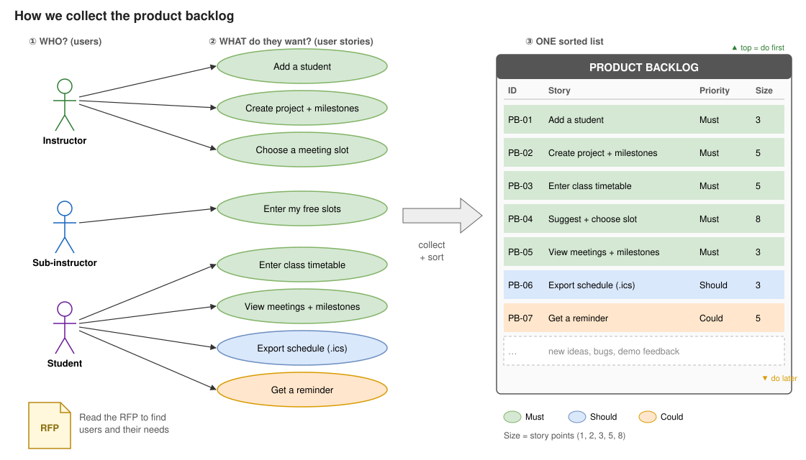

# Week 2 – Product Backlog (Oct. 14, 2026)

**Goal this week:** make the **product backlog** for the Lab Student Management System.

**Deliverable:** product backlog (put it in this repository).

---

## 1. What is a product backlog?

A product backlog is **a list of everything users want from our system**.

- Each item is a **user story** (a short sentence about one user need).
- The **most important** items are at the **top**.
- The list **changes** every phase. We add, remove and re-order items.

### How is the backlog collected?

1. Find the **users** (read the RFP).
2. For each user, write **what they want** (user stories).
3. Put all stories in **one list** and **sort** it: most important at the top.

Later, we also add **new ideas, bugs and demo feedback** to the same list.

Each item usually has:

| Field | Meaning |
|-------|---------|
| **ID** | A number, e.g. PB-01 |
| **User story** | As a … I want … so that … |
| **Acceptance criteria** | How we check it is "done" |
| **Priority** | Must / Should / Could |
| **Size** | Story points (1, 2, 3, 5, 8) |

Most items are **user stories** (new functions). A backlog can also hold **bug fixes** and
**improvements**.

## 2. How to write a user story

Use this template:

> **As a** `<user>`, **I want** `<function>` **so that** `<benefit>`.

| Part | Question | Example |
|------|----------|---------|
| As a … | **Who** uses it? | instructor |
| I want … | **What** does it do? | to see free meeting slots for my students |
| so that … | **Why**? (the benefit) | I can plan meetings quickly |

**Good story:**
> As an **instructor**, I want **the system to suggest free meeting slots**, so that **I do not need to check every timetable myself**.

**Bad story:**
> Make a slot table in the database. ← no user, no benefit. This is a *task*, not a story.

### Check each story with INVEST

| Letter | Meaning | Simple check |
|--------|---------|--------------|
| **I** | Independent | Can we build it alone? |
| **N** | Negotiable | Can we discuss the details? |
| **V** | Valuable | Does a user get a benefit? |
| **E** | Estimable | Can we guess the work size? |
| **S** | Small | Can we finish it in one phase? |
| **T** | Testable | Can we check "done"? |

## 3. Steps (do this in your team)

1. **List the users.** From the RFP: instructor, sub-instructor, student.
2. **Read the RFP again.** Mark every "can …" / "must …" sentence. Each one is a story idea.
3. **Write stories.** Use the template. One story = one need.
4. **Add acceptance criteria.** 2–3 short checks that show the story is "done".
5. **Set priority.** Use **Must / Should / Could** (see below). Put "Must" at the top.
6. **Estimate size.** Use story points: **1, 2, 3, 5, 8**. Small = 1, big = 8.
   If a story is bigger than 8, split it.
7. **Review together.** Read the list as a team. Fix unclear or duplicate stories.

**Priority (MoSCoW):**
- **Must** – the RFP requires it. No system without it.
- **Should** – important, but the system works without it.
- **Could** – nice to have, if we have time.

## 4. Template (copy this)

| ID | User | Story (I want … so that …) | Acceptance criteria | Priority | Points |
|----|------|----------------------------|---------------------|----------|--------|
| PB-01 | | | | | |

## 5. Example for our project

| ID | User | Story | Acceptance criteria | Priority | Points |
|----|------|-------|---------------------|----------|--------|
| PB-01 | Instructor | I want to add a student so that I can manage my lab members. | Save ID, name, entry/graduation date, program, email. Error if ID already exists. | Must | 3 |
| PB-02 | Instructor | I want to create a project with milestones so that students know the deadlines. | Milestone has date, title, status (planned / late / completed). | Must | 5 |
| PB-03 | Student | I want to enter my class timetable so that meetings do not overlap my classes. | Click slots on a weekly grid. Cannot save an empty or invalid slot. | Must | 5 |
| PB-04 | Instructor | I want the system to suggest free slots so that I can plan meetings quickly. | Shows only slots free for all selected people. I choose the final slot. | Must | 8 |
| PB-05 | Student | I want to see my meetings and milestones so that I can prepare. | Shows a calendar of my meetings and milestone status. | Must | 3 |
| PB-06 | Student | I want to export my schedule as an `.ics` file so that I can use Google Calendar. | File opens in Google Calendar and Outlook. | Should | 3 |
| PB-07 | Student | I want a reminder before a meeting so that I do not forget it. | Reminder is sent 1 day before. | Could | 5 |

## 6. Where to keep the backlog

Choose **one**:
- A Markdown table in this repository (easy), **or**
- **GitHub Issues + GitHub Projects** board (one issue = one story). Good for tracking who does what.

## 7. Checklist before you submit

- [ ] Every story has a **user**, a **function** and a **benefit**
- [ ] Every RFP "must" function has at least one story
- [ ] Every story has acceptance criteria
- [ ] Every story has a priority and points
- [ ] The list is sorted: most important at the top

---

## References

**Japanese (日本語)**
- スクラムガイド 2020（日本語版）: https://scrumguides.org/docs/scrumguide/v2020/2020-Scrum-Guide-Japanese.pdf  – see 「プロダクトバックログ」

**English (easy, with pictures)**
- Atlassian – Product backlog: https://www.atlassian.com/agile/scrum/backlogs
- Atlassian – User stories (with examples): https://www.atlassian.com/agile/project-management/user-stories
- Mountain Goat Software – User stories: https://www.mountaingoatsoftware.com/agile/user-stories
- INVEST: https://en.wikipedia.org/wiki/INVEST_(mnemonic)
- MoSCoW method: https://en.wikipedia.org/wiki/MoSCoW_method
- GitHub Projects (how to make a board): https://docs.github.com/en/issues/planning-and-tracking-with-projects/learning-about-projects/quickstart-for-projects

**Course**
- Our RFP: [../ie04_project2026_RFP.pdf](../ie04_project2026_RFP.pdf)
- Week 1 summary: [../week-1/README.md](../week-1/README.md)
