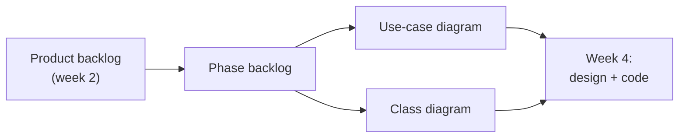
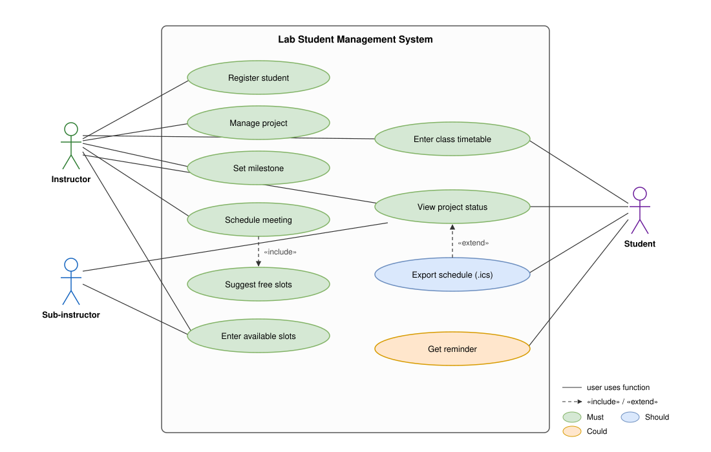
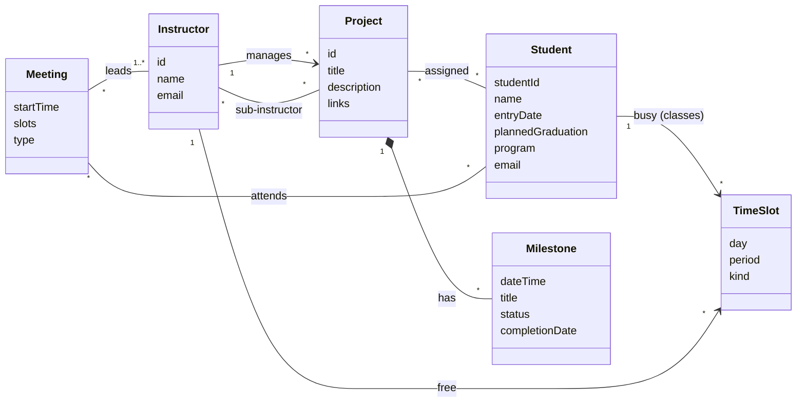

# Week 3 – Phase 1: Requirements and Use Cases (Oct. 21, 2026)

**Goal this week:** decide **what to build in Phase 1**, and draw the first models.

**Deliverables (3):**
1. **Phase backlog** – the stories we build in Phase 1
2. **Use-case diagram** – who uses which function
3. **Class diagram (model)** – what data the system keeps

Phase 1 demo is on **Nov. 4 (week 5)**. You need **working code** by then.

---

## 1. Phase backlog

The phase backlog is **a small part of the product backlog**: only the stories for this phase,
split into **tasks**.

**Steps:**
1. Take the **top stories** (Must) from the product backlog.
2. Check the **total size**. Pick only what the team can finish in ~2 weeks.
3. Split each story into **tasks** (UI, database, logic, test).
4. Give each task an **owner** and a **due date**.

**Tip:** choose stories that make a **working flow** for the demo.
For example: *add a student → create a project → see it on the status page.*

**Example:**

| Story | Task | Owner | Due | Status |
|-------|------|-------|-----|--------|
| PB-01 Add a student | Make the student input form | A | 10/28 | To do |
| | Make the `students` table in the database | B | 10/28 | To do |
| | Check for duplicate student ID | B | 10/30 | To do |
| PB-02 Create project + milestones | Project form and list page | C | 10/30 | To do |
| | Milestone form (date, title, status) | C | 11/1 | To do |
| PB-05 View status | Status page for a student | D | 11/1 | To do |

Status = **To do / Doing / Done**. Update it every week.

---

## 2. Use-case diagram

A use-case diagram shows **who (actor)** uses **which function (use case)** of the system.

### Parts

| Symbol | Name | Meaning |
|--------|------|---------|
| Stick figure | **Actor** | A user (or another system) **outside** our system |
| Oval | **Use case** | One function the user does. Write it as **verb + noun** (e.g. "Register student") |
| Big box | **System boundary** | Our system. Use cases go **inside**, actors go **outside** |
| Solid line | **Association** | This actor uses this use case |
| Dashed arrow «include» | Include | A use case **always** uses another (Schedule meeting → Suggest free slots) |
| Dashed arrow «extend» | Extend | An **optional** extra step (Export .ics is an option of View status) |

### Example for our project

### Steps
1. Write the **actors**: Instructor, Sub-instructor, Student.
2. Turn each **user story** into a **use case** (one oval). Use the backlog IDs to match them.
3. Connect each actor to the use cases they use.
4. Add «include» / «extend» **only when needed**. Keep it simple.
5. Check: every Phase 1 story has a use case.

**Common mistakes**
- ❌ "Click button", "Open page" → too small. ✅ "Register student".
- ❌ "Database" as an actor → the database is **inside** our system.
- ❌ Arrows that show **order** (step 1 → step 2). A use-case diagram is **not** a flowchart.

---

## 3. Class diagram (model)

A class diagram shows **what data** the system keeps and **how the data is connected**.
In MVC, these are the **Model** classes.

**How to find classes:** read the RFP and your stories. **Nouns** become classes or attributes.
> "An instructor sets **milestones** with **date**, **title** and **status** for a **project**."
> → class `Milestone` with attributes `date`, `title`, `status`. It belongs to `Project`.

### Example for our project

### How to read it
- **Box** = class. Top = name, below = attributes (data).
- **Line** = relation. Numbers show **how many**: `1` = one, `*` = many.
  - *"Instructor 1 → * Project"* = one instructor manages many projects.
- **Black diamond** (`*--`) = **part of**. A milestone cannot exist without its project.

### Steps
1. List the **nouns** from the RFP and stories.
2. Decide: is it a **class** (has its own data) or an **attribute** (one value)?
3. Add the **relations** and **numbers** (1, *).
4. Only draw what **Phase 1** needs. You will add more later.

---

## 4. Tools

| Tool | Good for | Link |
|------|----------|------|
| **draw.io** (free, in browser) | Use-case and class diagrams by mouse | https://app.diagrams.net/ |
| **PlantUML** (text → diagram) | Diagrams as text in Git | https://plantuml.com/ja/ (日本語) |
| **Mermaid** (text → diagram) | Shows directly on GitHub README | https://mermaid.js.org/syntax/classDiagram.html |

Save the diagram **file** (`.drawio`, `.puml`) **and** an **image** (`.png`/`.svg`) in the repository.

## 5. Checklist before you submit

- [ ] Phase backlog: stories, tasks, owners, due dates
- [ ] Phase 1 stories make one **working flow** for the demo
- [ ] Use-case diagram: actors outside, use cases inside the system box
- [ ] Every Phase 1 story has a use case
- [ ] Class diagram: classes, attributes, relations with numbers
- [ ] All files are in the repository

---

## References

**Japanese (日本語)**
- PlantUML ユースケース図: https://plantuml.com/ja/use-case-diagram
- PlantUML クラス図: https://plantuml.com/ja/class-diagram

**English**
- draw.io – Use case diagrams: https://www.drawio.com/blog/uml-use-case-diagrams
- UML use-case diagrams (detailed): https://www.uml-diagrams.org/use-case-diagrams.html
- UML class diagrams (detailed): https://www.uml-diagrams.org/class-diagrams-overview.html
- Atlassian – Sprint (phase) backlog: https://www.atlassian.com/agile/scrum/sprint-backlog

**Course**
- RFP: [../ie04_project2026_RFP.pdf](../ie04_project2026_RFP.pdf)
- Week 2 – Product backlog: [../week-2/README.md](../week-2/README.md)
