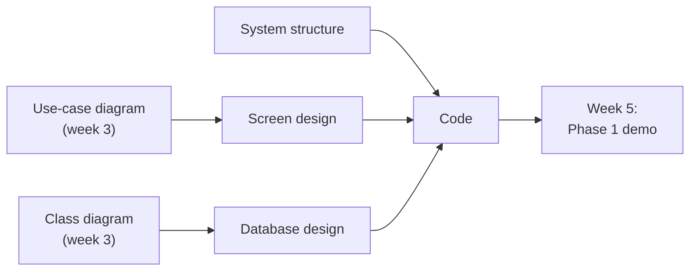
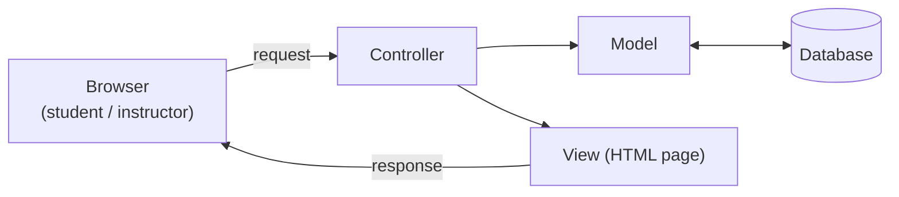
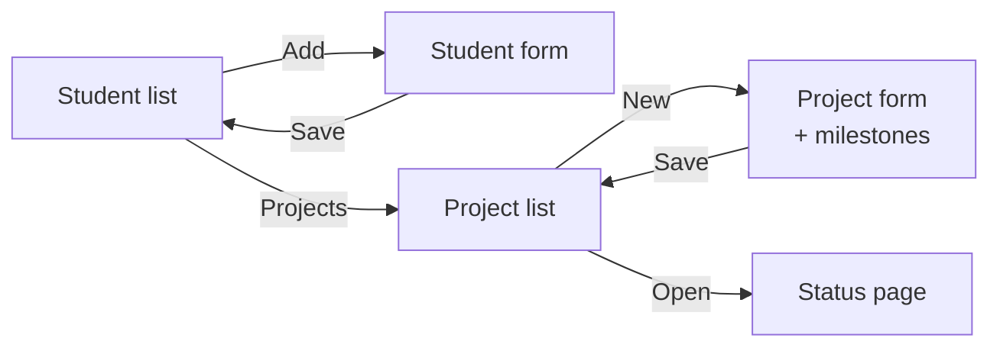
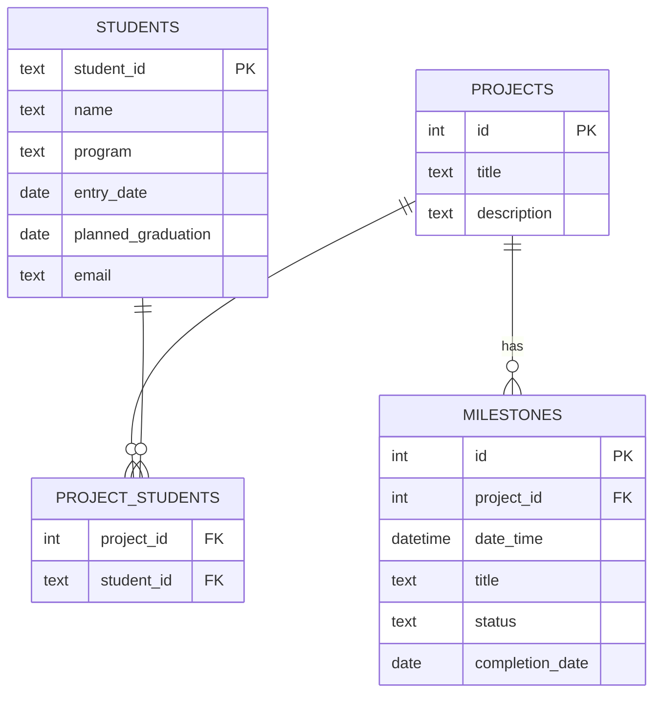

# Week 4 – Phase 1: Design and Coding (Oct. 28, 2026)

**Goal this week:** turn the week 3 models into a **design**, and **start coding**.

**Deliverables (4):**
1. **System structure (architecture)** – which parts the system has and how they talk
2. **Screen design** – a sketch of each Phase 1 page
3. **Database design** – the tables, made from the class diagram
4. **First working code** – in the repository, with an update to the phase backlog

Phase 1 demo is **next week, Nov. 4 (week 5)**. At the end of this week, the
**main flow should already run** (even if it looks ugly).



---

## 1. System structure (architecture)

The RFP (section 2.2) says the system is a **server** that **clients** use over the **network**.
Students and instructors use it **on and off campus**, from PCs or other devices.
So a **web application** is the simplest choice: users only need a browser.

We use **MVC** (Model – View – Controller):

| Part | Job | Example in our project |
|------|-----|------------------------|
| **Model** | Keeps the data. Reads and writes the database | `Student`, `Project`, `Milestone` (from the class diagram) |
| **View** | What the user sees (pages, forms) | Student list page, project form |
| **Controller** | Gets the user's request, calls the model, picks the view | "Save new student" → check input → save → show list |



In week 3 you chose the **backend server**, **frontend** and **database**, and ran "Hello World".
This week, put the MVC parts **into that project**.

**Steps:**
1. Draw the structure (like the diagram above) with **your** tool names from week 3.
2. Decide which **folders/files** hold the models, views and controllers.
3. Add this structure to the README, next to the framework choices from week 3.

**Tip:** do not change the framework now. You have **one week** before the demo.

---

## 2. Screen design

Draw a **simple sketch** (wireframe) of each page in the Phase 1 flow.
A wireframe shows **what is on the page** and **where**. No colors or design yet.

**Steps:**
1. Take each **use case** for Phase 1 and decide which page does it.
2. Draw each page: title, inputs, buttons, lists.
3. Draw **arrows between pages** (which button goes where). This is the **screen flow**.

**Example: screen flow for Phase 1**



**Example: wireframe of the student form**

```text
+-----------------------------------------+
|  Add student                            |
|                                         |
|  Student ID   [ s1300001          ]     |
|  Name         [                   ]     |
|  Program      [ Undergraduate   v ]     |
|  Entry date   [ 2026-04          ]      |
|  Graduation   [ 2027-03          ]      |
|  Email        [                   ]     |
|                                         |
|          [ Cancel ]   [ Save ]          |
+-----------------------------------------+
```

Paper and a phone photo is OK. Put the image in `images/`.

---

## 3. Database design

Make the **tables** from your **class diagram**. Usually:

| Class diagram | Database |
|---------------|----------|
| Class | **Table** |
| Attribute | **Column** |
| `1` → `*` relation | **Foreign key** in the "many" table (e.g. `milestones.project_id`) |
| `*` – `*` relation | A **join table** with two foreign keys (e.g. `project_students`) |

**Example (Phase 1 only):**



**Check:**
- Every table has a **primary key** (PK) – one value that is unique for each row.
- `status` should have a **fixed list** of values (e.g. *To do / Doing / Done*).
- Only make the tables **Phase 1** needs. Meetings and time slots can wait.

---

## 4. Start coding

**Steps:**
1. Start from the **"Hello World" project** from week 3. Add the folders for MVC and the
   database setup, and push it **first**. Everyone else pulls it.
2. Each member takes **tasks from the phase backlog** and works on a **branch**
   (e.g. `feature/student-form`).
3. Open a **pull request**. Another member reviews it, then merge to `main`.
4. Keep the **"How to run"** section in the README up to date, so anyone can start the app.
5. Update the **phase backlog** status (To do / Doing / Done).

**Order of work** (so the flow runs early):
1. Database tables
2. One page that **saves** and **lists** data (e.g. students)
3. The next page in the flow
4. Input checks (e.g. duplicate student ID)

**Common mistakes**
- ❌ Everyone works on `main` → many conflicts. ✅ One branch per task.
- ❌ Making every page beautiful first. ✅ First make the **whole flow work**.
- ❌ "It works on my PC". ✅ Another member follows "How to run" and checks it.

---

## 5. Weekly report

The RFP (section 3.1.1) asks for a **progress report every week**. Keep it short:

| Item | Example |
|------|---------|
| Done this week | Student form and list work. DB tables made. |
| Plan for next week | Project form, status page, demo practice |
| Problems | Date format is different between members' PCs |
| Phase backlog | 5 / 9 tasks Done |

---

## 6. Checklist before you submit

- [ ] System structure diagram (MVC) using the framework from week 3
- [ ] Wireframe for every Phase 1 page + screen flow
- [ ] Database tables made from the class diagram
- [ ] Code is in the repository; app starts with the "How to run" steps
- [ ] At least one page saves and lists data
- [ ] Phase backlog status is updated
- [ ] Weekly report is written

---

## References

**Japanese (日本語)**
- MDN Web Docs – サーバーサイドウェブサイトプログラミング: https://developer.mozilla.org/ja/docs/Learn/Server-side
- PlantUML ER図: https://plantuml.com/ja/ie-diagram

**English**
- MVC (MDN glossary): https://developer.mozilla.org/en-US/docs/Glossary/MVC
- Mermaid ER diagrams: https://mermaid.js.org/syntax/entityRelationshipDiagram.html
- Wireframes in draw.io: https://www.drawio.com/blog/wireframing
- GitHub flow (branches and pull requests): https://docs.github.com/en/get-started/using-github/github-flow

**Course**
- RFP: [../ie04_project2026_RFP.pdf](../ie04_project2026_RFP.pdf)
- Week 3 – Phase backlog, use cases, class diagram, framework + Hello World: [../week-3/README.md](../week-3/README.md)
