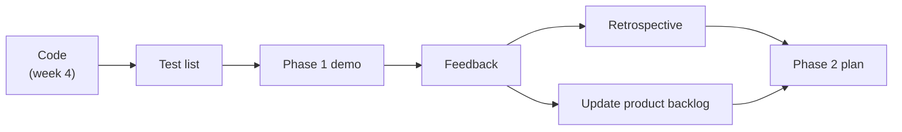

# Week 5 – Phase 1: Demo and Review (Nov. 4, 2026)

**Goal this week:** show the **Phase 1 demo**, get feedback, and **plan Phase 2**.

**Deliverables (4):**
1. **Phase 1 demo** – the main flow runs live on the backend server
2. **Test list** – what you checked before the demo, and the result
3. **Retrospective** – what went well, what to change
4. **Phase 2 plan** – updated product backlog and the next phase backlog

This is the **first of at least three demos** (RFP section 3.1.2). A demo is for
**checking the main design decisions** and **sharing problems** early, not for a perfect product.

---

## 1. Before the demo: finish and freeze

**Steps:**
1. Merge all finished branches into `main`. **Stop adding features** the day before the demo.
2. A member who did **not** write the code starts the app from the README **"How to run"**
   on a clean PC. If it fails, fix the README or the code.
3. Make **demo data**: a few students, one project with 3–4 milestones.
   Put it in a script or SQL file (e.g. `seed.sql`), so you can reset the data quickly.
4. Move unfinished tasks to **"To do"** in the phase backlog. Do **not** hide them.

**Tip:** a small flow that works is better than many pages that break.

---

## 2. Test list

Check each Phase 1 story by hand, and write the result. Use the **use cases** from week 3.

**Example:**

| # | Story / use case | Steps | Expected result | Result |
|---|------------------|-------|-----------------|--------|
| T1 | PB-01 Register student | Fill the form, press Save | Student shows in the list | ✅ |
| T2 | PB-01 Register student | Use a student ID that already exists | Error message, not saved | ✅ |
| T3 | PB-01 Register student | Leave Name empty | Error message, not saved | ❌ (saved) |
| T4 | PB-02 Create project | Add project with 3 milestones | All 3 milestones show | ✅ |
| T5 | PB-05 View status | Open status page of a student | Shows project and milestone status | ✅ |

**Check:**
- Test **normal input** and **wrong input** (empty, duplicate, wrong date).
- A ❌ is OK. Write it down, and add a task to fix it.

---

## 3. The demo

Each team has about **10 minutes**. A simple plan:

| Time | Who | What |
|------|-----|------|
| 1 min | A | The goal of Phase 1 and which stories you chose |
| 2 min | B | System structure (MVC) and database tables |
| 5 min | C | **Live demo** of the main flow: add student → create project → view status |
| 2 min | D | What is not done yet, problems, and questions for the instructor |

**Steps:**
1. Write a short **demo script** (the clicks, in order). Practice it **at least once**.
2. Run the demo from the **backend server**, with the demo data loaded.
3. Keep **screenshots** as a backup, in case the network or PC fails.
4. One member **writes down all feedback** during the demo.

**Common mistakes**
- ❌ Typing data live and making mistakes. ✅ Use the prepared demo data.
- ❌ Showing code line by line. ✅ Show what the **user** does.
- ❌ Hiding problems. ✅ Tell them. The demo is the place to **share concerns**.

---

## 4. Retrospective

After the demo, the team talks for **15–20 minutes**. Write the answers in the repository.

| Question | Example |
|----------|---------|
| What went well? | DB design was done early. Branches and pull requests worked. |
| What did not go well? | Two members had a different Python version. Testing was late. |
| What will we change? | Write the version in "How to run". Test each pull request before merge. |

Choose **1–2 changes** only, and really do them in Phase 2.

---

## 5. Plan Phase 2

**Steps:**
1. Add the **demo feedback** to the **product backlog** as new stories or changes.
2. Look again at the **priority** (Must / Should / Could). Feedback can change it.
3. Choose the stories for Phase 2. Likely next: **meeting scheduling** (time slots, suggested
   meeting times) and **calendar export (.ics)** from the RFP.
4. Make the **Phase 2 backlog** like week 3: tasks, owners, due dates.
5. Update the **class diagram** and **database design** for new data (e.g. `Meeting`, `TimeSlot`).

---

## 6. Weekly report

Same format as week 4, plus the demo:

| Item | Example |
|------|---------|
| Done this week | Phase 1 demo. 9 / 10 tests passed. |
| Feedback | Show milestone due dates in red when late |
| Plan for next week | Phase 2 backlog, time slot input page |
| Problems | Empty-name check is missing (T3) |

---

## 7. Checklist before you submit

- [ ] All Phase 1 work is merged into `main`, and the app starts with "How to run"
- [ ] Demo data script is in the repository
- [ ] Test list with results; failed tests have a fix task
- [ ] Demo done; feedback is written down
- [ ] Retrospective: went well / not well / 1–2 changes
- [ ] Product backlog updated with the feedback
- [ ] Phase 2 backlog: stories, tasks, owners, due dates
- [ ] Weekly report is written

---

## References

**English**
- Atlassian – Sprint review (demo): https://www.atlassian.com/agile/scrum/sprint-reviews
- Atlassian – Sprint retrospective: https://www.atlassian.com/agile/scrum/sprint-retrospective
- Atlassian – Backlog refinement: https://www.atlassian.com/agile/scrum/backlog-refinement

**Course**
- RFP: [../ie04_project2026_RFP.pdf](../ie04_project2026_RFP.pdf)
- Week 3 – Phase backlog, use cases, class diagram: [../week-3/README.md](../week-3/README.md)
- Week 4 – Design and first code: [../week-4/README.md](../week-4/README.md)
