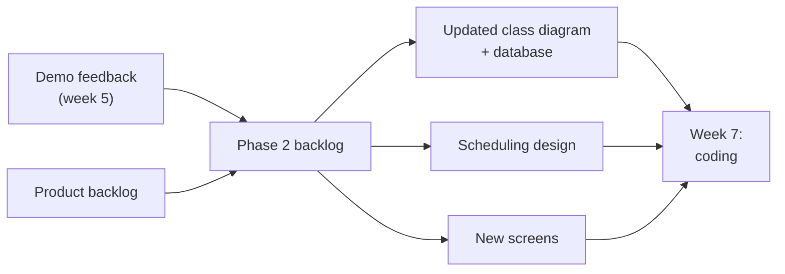
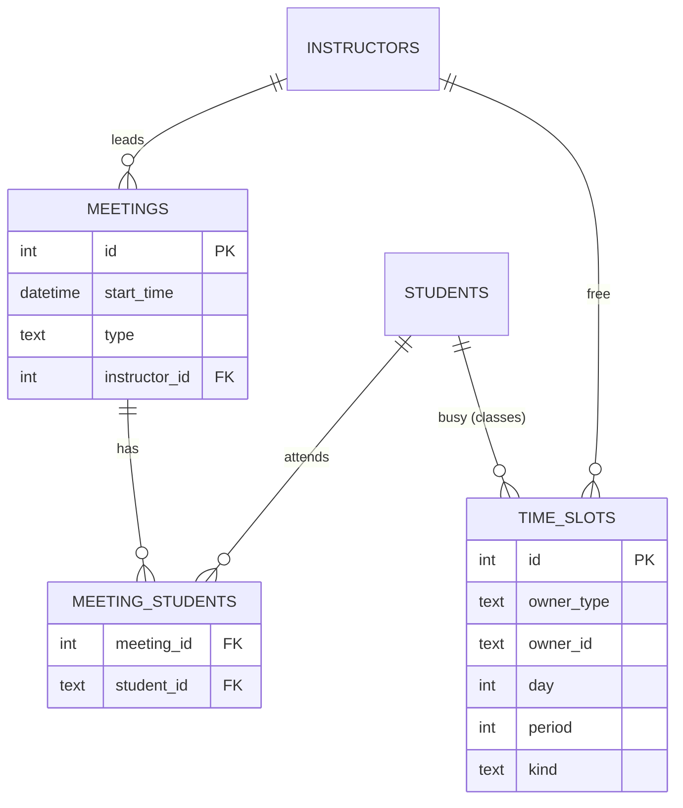
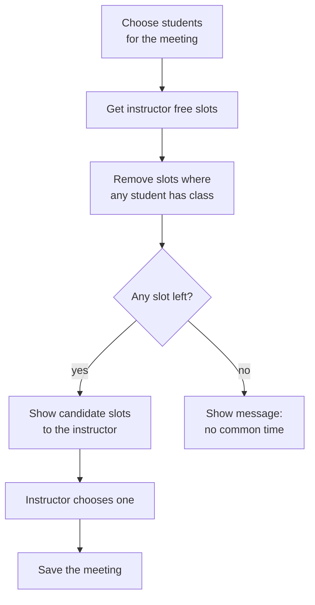
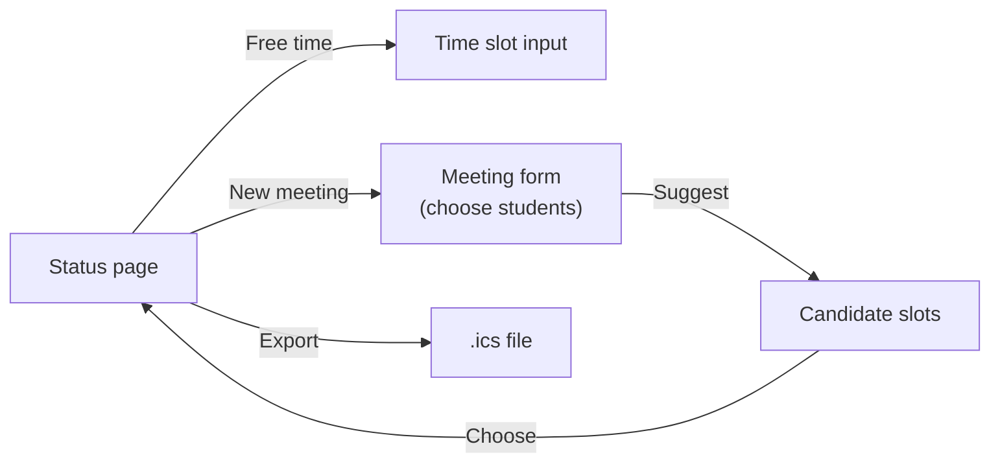

# Week 6 – Phase 2: Planning and Design (Nov. 11, 2026)

**Goal this week:** start **Phase 2**. Decide what to build, design the **meeting scheduling**
function, and make the database ready.

**Deliverables (4):**
1. **Phase 2 backlog** – the stories for Phase 2, split into tasks (using the demo feedback)
2. **Updated models** – class diagram and database design with `Meeting` and `TimeSlot`
3. **Scheduling design** – how the system suggests meeting times
4. **Screen design for Phase 2** – wireframes and screen flow for the new pages

Phase 1 is done. Phase 2 builds **on the same project**. Do not start again from zero.



---

## 1. Phase 2 backlog

Same steps as week 3, now with the **feedback from the Phase 1 demo**.

**Steps:**
1. List the **feedback and failed tests** from week 5. Fix tasks go **first**.
2. Take the next **Must / Should** stories from the product backlog.
   From the RFP: **meeting scheduling** and **calendar export (.ics)**.
3. Check the **size**. Pick only what the team can finish in the time before the next demo.
4. Split each story into **tasks** (UI, database, logic, test), with an **owner** and a **due date**.

**Example:**

| Story | Task | Owner | Due | Status |
|-------|------|-------|-----|--------|
| FIX Empty name is saved | Add input check for Name | A | 11/13 | To do |
| PB-03 Enter free time | Time slot input page (instructor) | B | 11/18 | To do |
| | Class timetable input (student) | C | 11/18 | To do |
| PB-04 Suggest meeting time | Suggestion logic | D | 11/22 | To do |
| | Suggestion result page | D | 11/25 | To do |
| PB-06 Export calendar | Make `.ics` file for meetings | C | 11/28 | To do |

**Tip:** keep one **working flow** again: *enter free time → suggest meeting → choose → see it on the status page.*

---

## 2. Update the class diagram and database

Phase 1 had `Student`, `Project` and `Milestone`. Phase 2 adds the meeting data from the week 3
class diagram.

**New classes (from the RFP):**
- `TimeSlot` – a day and a period when a person is **free** (instructor) or **busy with class** (student)
- `Meeting` – start time, type, who attends, who leads



**Steps:**
1. Update the **class diagram** (week 3) with the new classes and relations.
2. Update the **database design**. Use the same rules as week 4 (class → table, `*`–`*` → join table).
3. Write a **migration** (a script that changes the tables) and put it in the repository.
   Do **not** edit the database by hand, or other members will have a different database.

**Check:**
- `kind` has a fixed list of values (e.g. *free / class*).
- `day` and `period` use numbers that match the university timetable (e.g. period 1–5).

---

## 3. Scheduling design

The RFP says: the system **suggests** meeting slots that **avoid students' classes** and **match
the instructor's free time**. The instructor makes the **final choice**.

**Idea:** a slot is a *candidate* if the instructor is free **and** no attending student has class.



**Example:**

| Slot | Instructor | Student A | Student B | Candidate? |
|------|-----------|-----------|-----------|------------|
| Mon 3 | free | class | free | ❌ |
| Tue 2 | free | free | free | ✅ |
| Wed 4 | busy | free | free | ❌ |
| Thu 5 | free | free | free | ✅ |

**Steps:**
1. Write the rule in **plain words** (as above) in the README.
2. Write **test cases** now (e.g. the table above). They become your tests in week 7.
3. Decide the **edge cases**: no common slot, one student only, meeting already in that slot.

**Tip:** put the logic in **one function** (e.g. `suggest_slots(students, instructor)`),
separate from the web page. It is easier to test.

---

## 4. Screen design for Phase 2

Same as week 4: a **wireframe** for each new page and **arrows between pages**.



```text
+-----------------------------------------+
|  Suggested times                        |
|                                         |
|  ( ) Tue  period 2                      |
|  ( ) Thu  period 5                      |
|                                         |
|        [ Back ]   [ Choose ]            |
+-----------------------------------------+
```

---

## 5. Weekly report

| Item | Example |
|------|---------|
| Done this week | Phase 2 backlog. Class diagram and DB updated. |
| Plan for next week | Time slot input, suggestion logic |
| Problems | Not sure how to treat classes on different quarters |
| Phase backlog | 0 / 8 tasks Done (new phase) |

---

## 6. Checklist before you submit

- [ ] Phase 2 backlog: fix tasks from the demo + new stories, with owners and due dates
- [ ] Class diagram updated (`Meeting`, `TimeSlot`)
- [ ] Database design updated, with a **migration** in the repository
- [ ] Scheduling rule is written in plain words, with test cases
- [ ] Wireframes and screen flow for the new pages
- [ ] Weekly report is written

---

## References

**English**
- iCalendar (RFC 5545): https://datatracker.ietf.org/doc/html/rfc5545
- Mermaid ER diagrams: https://mermaid.js.org/syntax/entityRelationshipDiagram.html
- Database migrations (overview): https://en.wikipedia.org/wiki/Schema_migration
- Atlassian – Sprint planning: https://www.atlassian.com/agile/scrum/sprint-planning

**Course**
- RFP: [../ie04_project2026_RFP.pdf](../ie04_project2026_RFP.pdf)
- Week 4 – Design and first code: [../week-4/README.md](../week-4/README.md)
- Week 5 – Demo and review: [../week-5/README.md](../week-5/README.md)
