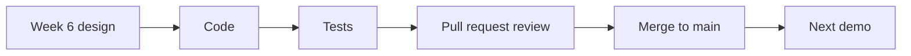

# Week 7 – Phase 2: Coding and Testing (Nov. 18, 2026)

**Goal this week:** build the **Phase 2 flow** and **test** it, so the next demo is ready.

**Deliverables (4):**
1. **Meeting scheduling** – enter free time, get suggested slots, choose one
2. **Calendar export** – meetings and milestones as an `.ics` file
3. **Automated tests** – for the scheduling logic
4. **Updated phase backlog and README** – status, "How to run", known problems



---

## 1. Build the scheduling flow

Follow the **order of work** (same idea as week 4), so the flow runs early:

1. **Database migration** from week 6 (everyone runs it).
2. **Time slot input** – instructor free time, student class times.
3. **Suggestion function** – `suggest_slots(...)`. First without any web page.
4. **Suggestion page** – show the candidate slots. The instructor chooses one.
5. **Save the meeting** and show it on the status page.

**Steps:**
1. Each member takes **tasks from the Phase 2 backlog** and works on a **branch**.
2. Open a **pull request** for every task. Another member reviews it, then merge.
3. Run the app after every merge. If `main` is broken, **fix it first**.

**Common mistakes**
- ❌ Putting the scheduling rule inside the page code. ✅ One function that is easy to test.
- ❌ Changing the database by hand. ✅ Use the migration script.
- ❌ Writing the whole thing, then testing. ✅ Test each step as you go.

---

## 2. Calendar export (.ics)

An `.ics` file is a plain **text** file that calendar apps (Google Calendar, Outlook, Apple
Calendar) can open. The RFP asks for this for **meetings and milestones**.

**Example (one meeting):**

```text
BEGIN:VCALENDAR
VERSION:2.0
PRODID:-//IE04 Lab//EN
BEGIN:VEVENT
UID:meeting-12@lab.example
DTSTAMP:20261118T090000Z
DTSTART:20261124T130000
DTEND:20261124T143000
SUMMARY:Weekly meeting
END:VEVENT
END:VCALENDAR
```

**Steps:**
1. Make a function that turns a meeting (or milestone) into one `VEVENT`.
2. Add a download link or button on the status page.
3. **Open the file in a real calendar app** and check the date and time are right.

**Check:**
- Each event has a **unique `UID`**.
- Time zone: decide one (e.g. Japan time) and use it everywhere.
- A library can help (e.g. `icalendar` for Python), but check the result in a calendar app.

---

## 3. Testing

Week 5 was hand testing. Now add **automated tests** for the scheduling logic.
A test runs the function with fixed input and checks the output.

**Example (Python, with `pytest`):**

```python
def test_slot_free_for_everyone():
    instructor_free = {("Tue", 2), ("Thu", 5), ("Mon", 3)}
    student_class = {("Mon", 3)}
    assert set(suggest_slots(instructor_free, [student_class])) == {("Tue", 2), ("Thu", 5)}

def test_no_common_slot():
    assert suggest_slots({("Mon", 3)}, [{("Mon", 3)}]) == []
```

Use the **test cases from week 6** (the candidate table) as your first tests.

**Steps:**
1. Write tests for: normal case, no common slot, one student, many students.
2. Write how to run them in the README (e.g. `pytest`).
3. Run all tests **before every pull request**.

**Tip:** if you write the test first and it fails, then make it pass, you know the test is real.

---

## 4. Prepare for the next demo

Use the same plan as week 5:

- Freeze features the day before. Prepare **demo data** (instructor free time, student classes).
- Demo flow: *enter free time → suggest meeting → choose → see on status page → export `.ics`.*
- Update the **test list**: Phase 1 tests still pass? (This is called a **regression check**.)

---

## 5. Weekly report

| Item | Example |
|------|---------|
| Done this week | Suggestion function with tests. Time slot page. |
| Plan for next week | `.ics` export, demo practice |
| Problems | Class times differ by quarter |
| Phase backlog | 6 / 8 tasks Done |

---

## 6. Checklist before you submit

- [ ] Instructor can enter free time; students' class times are stored
- [ ] The system suggests slots; the instructor chooses one; the meeting is saved
- [ ] `.ics` export works and opens in a calendar app
- [ ] Automated tests for the scheduling logic pass (`pytest` or similar)
- [ ] Phase 1 flow still works (regression check)
- [ ] "How to run" and "How to test" are in the README
- [ ] Phase backlog status is updated
- [ ] Weekly report is written

---

## References

**English**
- iCalendar (RFC 5545): https://datatracker.ietf.org/doc/html/rfc5545
- icalendar (Python library): https://icalendar.readthedocs.io/
- pytest – Get started: https://docs.pytest.org/en/stable/getting-started.html
- GitHub – Reviewing pull requests: https://docs.github.com/en/pull-requests/collaborating-with-pull-requests/reviewing-changes-in-pull-requests

**Course**
- RFP: [../ie04_project2026_RFP.pdf](../ie04_project2026_RFP.pdf)
- Week 5 – Demo and review: [../week-5/README.md](../week-5/README.md)
- Week 6 – Phase 2 planning and design: [../week-6/README.md](../week-6/README.md)
