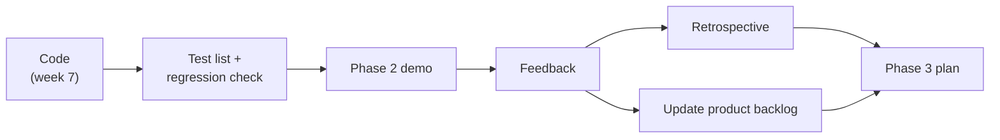

# Week 8 – Phase 2 Demo and Phase 3 Planning (Nov. 25, 2026)

**Goal this week:** show the **Phase 2 demo**, get feedback, and **plan Phase 3**.

**Deliverables (4):**
1. **Phase 2 demo** – meeting scheduling and `.ics` export run live
2. **Test list** – Phase 2 tests, and a check that Phase 1 still works
3. **Retrospective** – did the change from the Phase 1 retrospective work?
4. **Phase 3 plan** – updated product backlog, Phase 3 backlog, and design changes

This is the **second interim demo** (RFP section 3.1.2). The steps are the same as in
[week 5](../week-5/README.md). This guide only lists what is **new**.

---

## 1. Before the demo

Follow week 5 section 1 (merge, freeze, clean PC, demo data). New points:

1. **Run the Phase 1 tests again.** Phase 2 code can break old pages. This is a **regression check**.
2. Run the automated tests (`pytest` or similar) on `main`. They must pass.
3. Add **demo data for Phase 2**: instructor free time, student class times, 2–3 meetings.
4. Check the `.ics` file opens in a **real calendar app** on another PC.

---

## 2. Test list

Use the same table as week 5. Add the Phase 2 stories:

| # | Story | Steps | Expected | Result |
|---|-------|-------|----------|--------|
| T10 | Enter free time | Instructor saves 5 free slots | Slots show on the page | ✅ |
| T11 | Suggest meeting | Choose 2 students | Only slots free for **all three** people appear | ✅ |
| T12 | Suggest meeting | Students have no common free slot | Message "no common time" | ✅ |
| T13 | Export | Press Export on a meeting | `.ics` opens with the right date and time | ❌ (1 hour off) |
| R1 | Phase 1 check | Add student → project → status | Still works | ✅ |

A ❌ is OK. Write it down and add a fix task.

---

## 3. The demo

About **10 minutes**, like week 5. Change the plan a little:

| Time | What |
|------|------|
| 1 min | What changed since the Phase 1 demo (and the feedback you fixed) |
| 6 min | **Live demo**: enter free time → suggest meeting → choose → status page → export `.ics` |
| 2 min | Not done yet, problems |
| 1 min | Questions for the instructor |

**Tip:** show that the **Phase 1 feedback was used**. The customer wants to see that feedback leads to change.

---

## 4. Retrospective

Same questions as week 5. Add one more:

| Question | Example |
|----------|---------|
| Did we do the change we chose last time? | Yes: tests run before each pull request. Bugs found earlier. |
| What went well / not well? | |
| What will we change? (1–2 only) | |

---

## 5. Plan Phase 3

Phase 1 and 2 covered student registration, project planning, meetings and `.ics` export.
Look at the RFP again and list **what is still missing**.

| Topic | From the RFP | Ideas for Phase 3 |
|-------|--------------|-------------------|
| **Project status for all users** | Students, sub-instructors and the instructor view meetings, tasks and milestone status | Status pages for each role; each user sees only what they need |
| **Sub-instructors** | Instructor adds and updates sub-instructors | Sub-instructor registration and assignment to projects |
| **Login and roles** | Used on or off campus, on their own devices | Login; student can view, instructor can edit |
| **Extra functions** | "Propose functions that improve user experience and ease management" | Late-milestone alert, progress chart, meeting notes |
| **Handover** | No paid online DB; project account; hand over at delivery | Simple deployment, backup of the database, README for the customer |

**Steps:**
1. Add the **demo feedback** to the product backlog as stories or changes.
2. Re-check **priority** (Must / Should / Could).
3. Choose the Phase 3 stories. **Roles and status pages** first, extra functions after.
4. Make the **Phase 3 backlog** (tasks, owners, due dates).
5. Update the class diagram and database design (e.g. a `users` table with a `role` column).

---

## 6. Weekly report

| Item | Example |
|------|---------|
| Done this week | Phase 2 demo. 11 / 12 tests passed. |
| Feedback | Show the suggested slots sorted by date |
| Plan for next week | Login and roles, status pages |
| Problems | `.ics` time is 1 hour off (T13) |

---

## 7. Checklist before you submit

- [ ] Phase 1 and Phase 2 work is merged into `main`; the app starts with "How to run"
- [ ] Automated tests pass; Phase 1 flow still works
- [ ] Demo data is in the repository
- [ ] Test list with results; failed tests have a fix task
- [ ] Demo done; feedback is written down
- [ ] Retrospective, including whether last time's change worked
- [ ] Product backlog updated; Phase 3 backlog has owners and due dates
- [ ] Weekly report is written

---

## References

**English**
- Atlassian – Sprint review (demo): https://www.atlassian.com/agile/scrum/sprint-reviews
- Atlassian – Sprint retrospective: https://www.atlassian.com/agile/scrum/sprint-retrospective
- Regression testing (overview): https://en.wikipedia.org/wiki/Regression_testing
- OWASP – Authentication cheat sheet: https://cheatsheetseries.owasp.org/cheatsheets/Authentication_Cheat_Sheet.html

**Course**
- RFP: [../ie04_project2026_RFP.pdf](../ie04_project2026_RFP.pdf)
- Week 5 – Demo and review: [../week-5/README.md](../week-5/README.md)
- Week 7 – Phase 2 coding and testing: [../week-7/README.md](../week-7/README.md)
