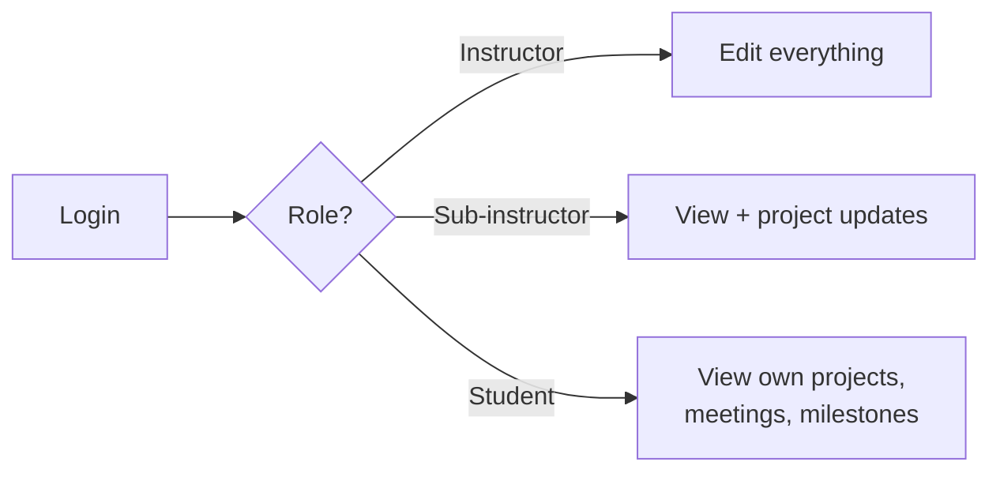

# Week 9 – Phase 3: Login, Roles and Status Pages (Dec. 2, 2026)

**Goal this week:** let each kind of user **log in** and see the **right pages**, and make the
system ready to hand over.

**Deliverables (4):**
1. **Login and roles** – instructor, sub-instructor, student
2. **Status pages** – meetings, tasks and milestone status for each role
3. **One extra function** – something that helps users (your proposal)
4. **Updated phase backlog and README** – status, "How to run", "How to test"



---

## 1. Login and roles

The RFP says users use the system **on and off campus** with **their own devices**. So the
system needs to know **who** is using it, and what they may do.

| Role | Can do (suggestion; confirm with the instructor) |
|------|--------------------------------------------------|
| **Instructor** | Everything: register people, edit projects, milestones, meetings |
| **Sub-instructor** | View projects they help with; update milestone status |
| **Student** | View **own** projects, meetings and milestones. Change nothing |

**Steps:**
1. Add a `users` table (id, email, password hash, role) from the Phase 3 database design.
2. Make a **login page** and a **logout** button.
3. In the controller, **check the role** before every page that edits data.
4. Show only the menu items the role may use. (But the **server must also check**. Hiding a button is not security.)

**Check:**
- Never save passwords as plain text. Use a **hash** (e.g. `bcrypt`, or the one in your framework).
- A student who types the URL of an instructor page gets **"not allowed"**.
- Keep secrets (keys, passwords) **out of the repository**. Use a settings file that is not committed.

---

## 2. Status pages

RFP: students, sub-instructors and the instructor can **view the meeting schedules, tasks and
milestone status** for the project.

```text
+------------------------------------------------+
|  Project: Lab web system        (Logged in: s1300001)|
|                                                |
|  Milestones                                    |
|   11/18  Design done          [Done]           |
|   12/02  Phase 3 code         [Doing]          |
|   12/16  Final test           [To do]          |
|                                                |
|  Next meeting: Tue 12/08, period 2             |
|                           [ Export .ics ]      |
+------------------------------------------------+
```

**Steps:**
1. Make one status page per project, reusing your Phase 1 and 2 data.
2. Filter by role: a student sees **only own** projects.
3. Show late milestones clearly (e.g. a red date).

---

## 3. One extra function

The RFP asks you to **propose functions that improve user experience and ease management**.
Pick **one** small function that fits the time. Examples:

| Idea | What it does |
|------|--------------|
| Late-milestone list | The instructor sees all late milestones on one page |
| Progress bar | Done / total milestones per project |
| Meeting notes | Write a short note for each meeting |
| Email reminder | Remind students before a meeting (check cost: no paid service) |

Write in the README **why** this function helps. Do not start a second one until the first works.

---

## 4. Get ready to hand over

The RFP has rules for the delivery. Check each one now, not at the end.

- [ ] **No paid online database.** SQLite or a free self-hosted database is OK.
- [ ] Any online service uses a **project account**, not a personal one, and can be handed over.
- [ ] The app needs only a **browser** on the user's device.
- [ ] A new person can start the system with **"How to run"** only.
- [ ] There is a way to **back up** the database (e.g. copy the file, or a script).

---

## 5. Testing

- Add automated tests for **login and roles** (right role → page opens; wrong role → blocked).
- Run all tests before every pull request.
- Run the **Phase 1 and Phase 2 flows** again by hand (regression check).

---

## 6. Weekly report

| Item | Example |
|------|---------|
| Done this week | Login, roles, student status page |
| Plan for next week | Extra function, test everything, demo practice |
| Problems | Sub-instructor permissions are not decided |
| Phase backlog | 7 / 10 tasks Done |

---

## 7. Checklist before you submit

- [ ] Login and logout work; passwords are hashed
- [ ] Each role sees only the pages it may use; the **server** blocks the rest
- [ ] Status pages show meetings, tasks and milestone status
- [ ] One extra function works, with a reason in the README
- [ ] Handover checks (section 4) are done
- [ ] Automated tests pass; Phase 1 and 2 flows still work
- [ ] "How to run" and "How to test" are up to date
- [ ] Phase backlog status is updated
- [ ] Weekly report is written

---

## References

**English**
- OWASP – Authentication cheat sheet: https://cheatsheetseries.owasp.org/cheatsheets/Authentication_Cheat_Sheet.html
- OWASP – Password storage cheat sheet: https://cheatsheetseries.owasp.org/cheatsheets/Password_Storage_Cheat_Sheet.html
- OWASP – Top 10 (broken access control): https://owasp.org/Top10/
- SQLite – Backup: https://www.sqlite.org/backup.html

**Course**
- RFP: [../ie04_project2026_RFP.pdf](../ie04_project2026_RFP.pdf)
- Week 7 – Phase 2 coding and testing: [../week-7/README.md](../week-7/README.md)
- Week 8 – Phase 2 demo and Phase 3 planning: [../week-8/README.md](../week-8/README.md)
